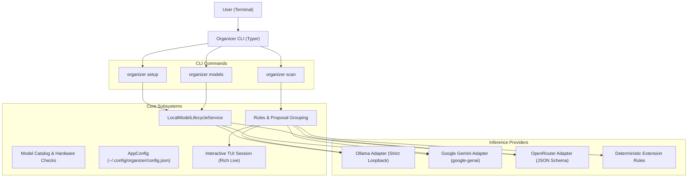

# Organizer CLI (`organizer`)

> **A private, local-first macOS folder organizer proposing an editable, folder-grouped file tree with local Gemma model lifecycle management and zero-RAM cloud fallbacks.**

[](https://www.python.org/downloads/)
[](LICENSE)
[](tests/)
[](https://apple.com)

---

## Table of Contents

- [Overview](#overview)
- [What We Built](#what-we-built)
  - [1. Multi-Engine Operational Modes](#1-multi-engine-operational-modes)
  - [2. Interactive First-Run Setup Wizard](#2-interactive-first-run-setup-wizard)
  - [3. Folder-Grouped Organization Plan & AI Indicators](#3-folder-grouped-organization-plan--ai-indicators)
  - [4. Interactive Keyboard TUI (`organizer scan`)](#4-interactive-keyboard-tui-organizer-scan)
  - [5. Local Model Lifecycle & Diagnostics Subsystem](#5-local-model-lifecycle--diagnostics-subsystem)
  - [6. Strict Local-Only Privacy Policy](#6-strict-local-only-privacy-policy)
  - [7. Deterministic Testing Harness & Acceptance Suite](#7-deterministic-testing-harness--acceptance-suite)
- [Architecture & Workflow](#architecture--workflow)
- [What Is Pending (In-Flight Roadmap)](#what-is-pending-in-flight-roadmap)
- [What Is Still Being Brainstormed](#what-is-still-being-brainstormed)
- [Installation & Quickstart](#installation--quickstart)
  - [Prerequisites](#prerequisites)
  - [Setup Virtual Environment](#setup-virtual-environment)
  - [Initial Setup](#initial-setup)
- [CLI Reference & Usage](#cli-reference--usage)
  - [Global Commands](#global-commands)
  - [`organizer scan` (Core Organization Workflow)](#organizer-scan-core-organization-workflow)
  - [`organizer setup` (Interactive Setup Wizard)](#organizer-setup-interactive-setup-wizard)
  - [`organizer models` (Model Lifecycle Subcommands)](#organizer-models-model-lifecycle-subcommands)
- [Interactive Keyboard Shortcuts Reference](#interactive-keyboard-shortcuts-reference)
- [Configuration Reference](#configuration-reference)
  - [Configuration File Path](#configuration-file-path)
  - [Environment Variables](#environment-variables)
  - [Example `config.json`](#example-configjson)
- [Development & Testing](#development--testing)

---

## Overview

macOS users frequently deal with cluttered folders such as `~/Downloads` or `~/Desktop` overflowing with invoices, documents, screenshots, project dossiers, code archives, and media. 

**Organizer CLI (`organizer`)** provides an intelligent, private, and human-in-the-loop organization workflow:
1. **Scans** a target folder and categorizes files using local on-device Gemma models (via Ollama), multimodal cloud reasoning (Google Gemini / OpenRouter), or deterministic extension rules.
2. **Aggregates** proposals into clean, folder-grouped tables with count badges and AI attribution stars (`📁 ⭐ Photographs (1 file)`).
3. **Presents** an interactive terminal UI where you can navigate files with arrow keys, select multiple items, and dynamically reassign target destinations with auto-completing suggestions before committing to changes.
4. **Guarantees** total privacy for local inference—enforcing strict loopback network checks so no sensitive documents or folder paths ever leak.

---

## What We Built

### 1. Multi-Engine Operational Modes

The organizer supports four interchangeable operational modes configured via `~/.config/organizer/config.json`:

| Mode | Engine / Provider | Privacy & Hardware Requirements | Description |
| :--- | :--- | :--- | :--- |
| **`ai` (Local)** | **Ollama** (`gemma4:e2b`, `gemma2:2b`, etc.) | **100% Private, On-Device**<br>Requires 4–8 GB unified host RAM | Direct communication with Ollama over local loopback (`http://localhost:11434`). Verifies model readiness, supports streaming download progress, and executes locally. |
| **`gemini` (Cloud)** | **Google Gemini API** (`gemini-3.8-flash` / `gemini-2.5-flash`) | **Free Cloud Tier**<br>Zero host RAM or GPU needed | Uses official `google-genai` SDK. Supports multimodal vision classification (images up to 10 MB) and text previews. Gracefully falls back to extension rules if cloud rate limits or demand spikes occur. |
| **`openrouter` (Cloud)** | **OpenRouter API** (`openrouter/free`) | **Free Cloud Meta-Router**<br>Zero host RAM or GPU needed | Free-tier cloud inference with strict JSON schema outputs (`response_format: json_schema`) for structured, dependable categorization. |
| **`rule-only` (Static)**| **Deterministic Rule Engine** | **Zero AI, Instant, Offline**<br>Runs on any machine | Categorizes files strictly by file extension and metadata without requiring Ollama, model weights, or internet access. |

### 2. Interactive First-Run Setup Wizard

Launching `organizer setup` (or running `organizer scan` when unconfigured) triggers a first-run onboarding wizard:
- **Runtime Detection**: Checks if Ollama is installed and whether the local server is running.
- **Graceful Diagnostics**: If Ollama is missing or stopped, provides clear instructions (Homebrew or Ollama app) without running unprompted privileged installers, and offers seamless fallback to Gemini, OpenRouter, or rule-only mode.
- **Curated Model Catalog**: Highlights recommended models tailored for 8 GB unified-memory Macs (such as `gemma4:e2b` multimodal at 7.5 GB).
- **Live Streaming Progress**: Downloads model layers with real-time transfer speeds, downloaded/total byte indicators, elapsed time, and cooperative cancellation tokens.
- **Readiness Smoke Tests**: Issues minimal test prompts before marking any model or provider active.

### 3. Folder-Grouped Organization Plan & AI Indicators

Instead of a flat list of repetitive file paths, the dry-run plan aggregates files under destination folder banners:
- Displays folder title and item counts: `📁 Documents (2 files)`, `📁 Images (1 file)`.
- **`⭐` AI Attribution Indicator**: AI-generated destination folders feature a prominent star badge (e.g. `📁 ⭐ Projects` or `📁 ⭐ Photographs`), distinguishing semantic AI insights from static deterministic extensions.
- Confidence scores and classification reasons are clearly presented per file.

### 4. Interactive Keyboard TUI (`organizer scan`)

Running `organizer scan <path>` in a TTY launches an interactive terminal session built on Rich Live:
- **Smooth Cursor Navigation**: Move up and down across all grouped folders using `↑`/`k` or `↓`/`j`.
- **Bluish Selection Highlighting**: Active cursor rows and selected items use subtle, non-intrusive bluish highlighting (`#1e3a5f` / `#172554`).
- **Clean Table Formatting**: Uses simple dividers (`box.SIMPLE_HEAD`) rather than heavy boxes.
- **Range & Multi-Selection**: Select individual files (`Space`), range select (`Shift+Space` or `Shift+↑`/`Shift+↓`), or deselect all (`d`).
- **Destination Reassignment (`m`)**: Press `m` to open an inline prompt. Type a new destination folder or hit `Tab` to cycle through intelligent suggestions (derived from existing folders, standard extension categories, and AI-suggested categories).
- **Non-Interactive Fallback**: Automatically renders a static grouped table when stdout is not a TTY or when passed `--non-interactive`.

### 5. Local Model Lifecycle & Diagnostics Subsystem

A full suite of CLI management subcommands under `organizer models`:
- `organizer models list`: Lists locally installed Ollama models with sizes and active status.
- `organizer models available`: Displays the curated catalog of verified models, modalities, and memory requirements.
- `organizer models install <model>`: Pulls model weights with progress reporting and hardware advisory checks.
- `organizer models use <model>`: Switches the active model with verification gates.
- `organizer models status`: Summarizes runtime status, active provider, API key readiness, and memory usage.
- `organizer models doctor`: Performs comprehensive health checks (binary check, loopback safety, RAM/disk check, API authentication).
- `organizer models remove <model>`: Safely deletes model files with mandatory user confirmation.

### 6. Strict Local-Only Privacy Policy

For local AI operation, the application enforces loopback URL validation:
- Only `localhost`, `127.0.0.1`, and `::1` are accepted as local model endpoints.
- Any attempt to configure an external IP address triggers a `NonLoopbackEndpointError`.
- Clear separation between one-time weight downloads and offline document inference.

### 7. Deterministic Testing Harness & Acceptance Suite

The test suite contains **115 passing unit and acceptance tests**:
- Includes `organizer.testing.fake_ollama`, an in-process mock HTTP server simulating stream chunking, pull interruptions, cancellation, missing byte counts, and prompt generation without downloading model weights during test runs.
- Full test coverage for CLI commands, interactive session state machines, catalog constraints, and cloud adapters.

---

## Architecture & Workflow



---

## What Is Pending (In-Flight Roadmap)

While the inspection, categorization, onboarding, and interactive review workflows are complete, the following capabilities are currently in active implementation:

1. **Physical File Execution Engine**:
   - Currently, confirming the interactive review plan (`Enter`) prints the finalized organization proposal in dry-run mode without modifying disk files.
   - Pending: The atomic move/copy execution engine that creates destination directories, performs non-destructive file relocation, handles collision policies (e.g. `file (1).pdf` vs skip), and outputs execution summaries.
2. **Undo & Rollback Subsystem (`organizer undo` / `organizer history`)**:
   - Storing atomic transaction manifests (`~/.config/organizer/manifests/<timestamp>.json`) recording original file paths, destination paths, hashes, and timestamps.
   - A dedicated `organizer undo` command to safely restore organized files to their original locations.
3. **Target Filename Renaming**:
   - The UI currently has `SHOW_TARGET_FILENAME: bool = False` keeping target filenames hidden to focus purely on folder organization.
   - Pending: Exposing an inline rename mode allowing users to edit target filenames or accept AI-suggested descriptive filenames.
4. **Direct Ollama Inference Integration in `scan`**:
   - Local model discovery, pulling, verification, and smoke tests are implemented in `OllamaProviderAdapter`.
   - Wiring local Ollama prompt generation directly into `scan_and_propose_tree` (parallel to Gemini and OpenRouter adapters) is the next step for local-mode scanning.

---

## What Is Still Being Brainstormed

The following features are under design evaluation for upcoming releases:

- **macOS Finder Tags & Metadata Integration**:
  - Writing native macOS Finder tags and color labels using `xattr` (`com.apple.metadata:_kMDItemUserTags`).
  - Preserving original file creation dates, modification dates, and Spotlight metadata.
- **Background Folder Watcher / Daemon (`organizer watch`)**:
  - Running a background folder daemon using macOS `fsevents` or `watchdog` to monitor `~/Downloads` for new incoming files and prompt for organization or file them automatically.
- **Custom User Rules Configuration (`rules.yaml`)**:
  - Allowing users to define custom mapping rules, regex patterns, or ignored file lists (e.g. `.crdownload`, `.part`, temporary lockfiles).
- **Duplicate & Deduplication Detection**:
  - Calculating fast cryptographic hashes (SHA-256) during scanning to warn users when exact duplicate files exist across directories.
- **Local Semantic Clustering & Embeddings**:
  - Generating local vector embeddings of documents to cluster related project documents into cohesive categories automatically without fixed taxonomy schemas.
- **Sidecar GUI / Menu Bar Companion**:
  - A lightweight macOS menu bar utility or graphical companion window providing thumbnail previews of images and PDFs alongside the organization plan.

---

## Installation & Quickstart

### Prerequisites

- **macOS** 12.0+ (Apple Silicon or Intel)
- **Python** 3.10, 3.11, 3.12, 3.13, or 3.14
- *(Optional for Local AI)* [Ollama](https://ollama.com) installed and running (`ollama serve` or Ollama macOS app).
- *(Optional for Cloud AI)* A free Google Gemini API key or OpenRouter API key.

### Setup Virtual Environment

Clone the repository and install dependencies in editable mode:

```bash
git clone https://github.com/BoseSj/OrgCLI.git
cd OrgCLI

# Create virtual environment
python3 -m venv .venv
source .venv/bin/activate

# Install organizer in development mode
pip install -e ".[dev]"
```

Verify that the CLI is accessible:

```bash
organizer --help
```

### Initial Setup

Launch the setup wizard:

```bash
organizer setup
```

Follow the prompts to select your operational preference:
- **Option 1**: Download or use the recommended local Gemma model (`gemma4:e2b`).
- **Option 2**: Configure Google Gemini API (uses `GEMINI_API_KEY` from your environment or prompts for one).
- **Option 3**: Configure OpenRouter (uses `OPENROUTER_API_KEY` for free cloud inference).
- **Option 4**: Select another local model from the catalog (`gemma2:2b`, `gemma2:9b`).
- **Option 5**: Enable rule-only mode (instant, zero models, deterministic).

Verify system health with doctor:

```bash
organizer models doctor
```

---

## CLI Reference & Usage

### Global Commands

```bash
# Show version
organizer --version

# Show top-level help and commands
organizer --help
```

---

### `organizer scan` (Core Organization Workflow)

Scans a directory recursively for files and presents the folder-grouped organization plan.

```bash
organizer scan [PATH] [OPTIONS]
```

#### Arguments
- `PATH`: Directory to scan and organize. Defaults to current directory (`.`).

#### Options
- `--interactive / --non-interactive`: Enable or disable the interactive terminal review session (defaults to interactive when running inside a TTY).
- `-c, --config PATH`: Explicit path to custom configuration file.

#### Examples

```bash
# Scan and interactively organize Downloads folder
organizer scan ~/Downloads

# Scan current directory with non-interactive output
organizer scan . --non-interactive

# Scan with custom config file
organizer scan ~/Desktop --config ./custom_config.json
```

---

### `organizer setup` (Interactive Setup Wizard)

Launches the first-run onboarding wizard to configure models, runtime checks, or cloud providers.

```bash
organizer setup [OPTIONS]
```

#### Options
- `-c, --config PATH`: Explicit path to custom configuration file.

---

### `organizer models` (Model Lifecycle Subcommands)

Inspect, install, switch, diagnose, and remove models.

#### 1. `organizer models status`
Displays the active operational mode, configured active model, API keys, and runtime status.

```bash
organizer models status
```

#### 2. `organizer models doctor`
Runs comprehensive diagnostic checks on Ollama binaries, local loopback API endpoints, host RAM, disk space, and cloud credentials.

```bash
organizer models doctor
```

#### 3. `organizer models available`
Lists all verified models in the local catalog along with download sizes, supported modalities, and minimum RAM recommendations.

```bash
organizer models available
```

#### 4. `organizer models list`
Queries the local Ollama instance and lists all models currently installed on your machine.

```bash
organizer models list
```

#### 5. `organizer models install <model_id>`
Downloads a model from Ollama with real-time streaming progress, verifying readiness upon completion.

```bash
# Install and set as active model
organizer models install gemma4:e2b

# Install without interactive confirmation prompt
organizer models install gemma2:2b --yes

# Download without making it active
organizer models install gemma2:9b --no-use
```

#### 6. `organizer models use <model_id>`
Switches the active model for future organization tasks, running a readiness smoke test first.

```bash
organizer models use gemma4:e2b
```

#### 7. `organizer models remove <model_id>`
Removes a model from local Ollama storage with mandatory confirmation.

```bash
# Remove with interactive prompt
organizer models remove gemma2:9b

# Remove without interactive prompt
organizer models remove gemma2:2b --yes
```

---

## Interactive Keyboard Shortcuts Reference

When running `organizer scan` in interactive mode, use the following keybindings to review and customize your organization plan:

| Key | Action | Description |
| :--- | :--- | :--- |
| `↑` / `k` | **Navigate Up** | Move the cursor highlight to the previous file row |
| `↓` / `j` | **Navigate Down** | Move the cursor highlight to the next file row |
| `Space` | **Toggle Select** | Select or deselect the file at the active cursor |
| `Shift+Space` | **Range Select** | Select all files between the last anchor and the current cursor |
| `Shift+↑` / `Shift+↓` | **Select & Move** | Expand multi-selection while moving cursor |
| `d` | **Deselect All** | Clear all active file selections |
| `m` | **Move to Folder** | Open destination reassignment prompt for selected files |
| `Tab` *(in Move prompt)* | **Cycle Suggestions** | Cycle through existing, standard, and AI-suggested folder names |
| `Enter` *(in Move prompt)* | **Apply Move** | Reassign selected files to the chosen/new folder |
| `Esc` *(in Move prompt)* | **Cancel Move** | Exit destination prompt without making changes |
| `Enter` *(in Browse mode)* | **Confirm Plan** | Confirm and finalize the organization plan |
| `q` / `Ctrl+C` | **Quit** | Cancel review session; no files are modified |

---

## Configuration Reference

### Configuration File Path

By default, settings are stored atomically in JSON format at:
```
~/.config/organizer/config.json
```
You can override the configuration path using the `--config` flag or by setting the `ORGANIZER_CONFIG_PATH` environment variable.

### Environment Variables

| Variable | Description |
| :--- | :--- |
| `GEMINI_API_KEY` | API key for Google Gemini cloud inference mode. |
| `OPENROUTER_API_KEY`| API key for OpenRouter cloud inference mode. |
| `ORGANIZER_CONFIG_PATH` | Custom path to application configuration file. |
| `ORGANIZER_FORCE_INTERACTIVE` | Set to `1` to force interactive TUI even in non-standard TTY environments (useful for testing). |

### Example `config.json`

```json
{
  "config_version": 1,
  "setup_completed": true,
  "operational_mode": "gemini",
  "active_model": "gemma4:e2b",
  "model_settings": {
    "endpoint": "http://localhost:11434",
    "context_length": 2048,
    "timeout_seconds": 30.0
  },
  "gemini_settings": {
    "model_name": "gemini-3.8-flash",
    "api_key": null,
    "timeout_seconds": 30.0
  },
  "openrouter_settings": {
    "model_name": "openrouter/free",
    "api_key": null,
    "base_url": "https://openrouter.ai/api/v1",
    "timeout_seconds": 30.0,
    "app_referer": "https://github.com/local-folder-organizer",
    "app_title": "Local Folder Organizer"
  }
}
```

---

## Development & Testing

The project maintains high engineering standards with comprehensive automated unit, scenario, and regression tests.

### Running Tests

Execute the full pytest suite:

```bash
# Run all tests
pytest

# Run tests with verbose output
pytest -v

# Run specific test modules
pytest tests/test_acceptance_scenarios.py
pytest tests/test_interactive_plan.py
pytest tests/test_setup.py
pytest tests/test_cli.py
```

### Static Analysis & Verification

```bash
# Verify test count and passing status
pytest -q
```

---

*Local Folder Organizer is built for macOS with privacy and human control at its center.*
