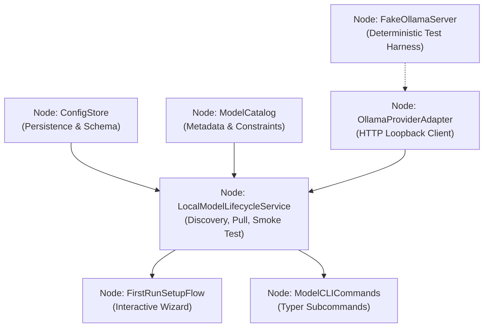

## Context

The OrgCLI tool provides private, local-first folder organization for macOS users (targeting machines such as an 8 GB MacBook Air). See `proposal.md` for motivation and background. Prior to this design, model management and startup evaluation were not formalized, risking fragmented subprocess calls and confusing startup failures when local AI runtimes are absent or unconfigured.

## Goals / Non-Goals

**Goals:**
- Provide a clean, decoupled architecture: separate model lifecycle management and runtime communication from semantic folder classification.
- Encapsulate Ollama HTTP communication inside a robust `OllamaProviderAdapter` adhering strictly to local loopback endpoints (`127.0.0.1`, `localhost`).
- Implement a model catalog containing metadata, verified modalities, parameter sizes, download sizes, and hardware advisories (e.g. Gemma 4 E2B).
- Provide an interactive, resumable first-run onboarding wizard with live progress bars, cancellation support, and smoke-testing readiness gates.
- Support deterministic, rule-only operation without any models or runtime required.
- Expose clear, testable Typer CLI commands (`organizer setup`, `organizer models ...`).
- Provide an in-process fake Ollama test server for 100% deterministic unit and integration testing without downloading model weights during test runs.

**Non-Goals:**
- Silently executing external or privileged installers for Ollama.
- Transmitting file paths, folder structures, or document metadata to cloud endpoints or remote inference APIs.
- Auto-deleting user files or uninstalled models without explicit confirmation.
- Concurrently loading multiple models into system RAM.

## Decisions

### Decision 1: Dedicated `OllamaProviderAdapter` over Raw Subprocesses or Monolithic CLI Code
- **Rationale**: Direct subprocess calls (`ollama pull ...`) are difficult to test deterministically, cannot easily report fine-grained byte progress, and leak terminal state. A dedicated adapter using `httpx` against Ollama's local REST API (`/api/tags`, `/api/pull`, `/api/show`, `/api/generate`, `/api/delete`) enables streaming progress iterators, robust cancellation, and clean dependency injection for unit tests.
- **Alternatives Considered**: Direct CLI subprocess execution was rejected due to fragile stdout parsing and inability to handle cancellation cleanly.

### Decision 2: Model Catalog with Explicit Modality Constraints
- **Rationale**: Not all Gemma models or local models support multimodal/vision input. The catalog explicitly defines `modalities: list[str]` (e.g. `["text"]` vs `["text", "image"]`) and minimum RAM guidelines. Models are recommended based on verified local performance on 8 GB unified-memory machines (Gemma 4 E2B is the default recommended lightweight candidate).
- **Alternatives Considered**: Dynamically querying arbitrary Ollama library tags at runtime was rejected because it requires network access during browsing and lacks verified modality safety.

### Decision 3: Separation of Startup Wizard from Core Execution
- **Rationale**: Placing setup logic directly into the default organizer execution command creates coupling and makes headless execution fragile. The `FirstRunSetupFlow` is invoked if configuration indicates setup is incomplete or when explicitly triggered via `organizer setup`.
- **Alternatives Considered**: Requiring users to configure everything via raw config file editing was rejected as poor UX.

### Decision 4: Deterministic Rule-Based Fallback as a First-Class Citizen
- **Rationale**: Users without Ollama or who prefer deterministic extension-based rules should still be able to organize folders. The configuration tracks `mode: "ai" | "rule-only"`.
- **Alternatives Considered**: Hard-failing on missing Ollama was rejected because the core folder organizer value proposition includes deterministic rules.

## Engineering Graph Nodes

The architecture forms an acyclic engineering graph with explicit verification gates:

### Engineering Graph Node Contracts & Verification Gates:

1. **`Node:ConfigStore`**
   - **Inputs**: File system path `~/.config/organizer/config.json`.
   - **Outputs**: Strongly typed `AppConfig` with active model and operational mode.
   - **Verification Gate**: Unit tests verify save/load roundtrips, schema validation, and default initialization.

2. **`Node:ModelCatalog`**
   - **Inputs**: Model identifier queries.
   - **Outputs**: `CatalogEntry` with modalities, download size, parameter size, hardware advisory.
   - **Verification Gate**: Catalog tests verify Gemma 4 E2B metadata, modality checks, and memory advisories.

3. **`Node:OllamaProviderAdapter`**
   - **Inputs**: Local endpoint URL (strictly validated to loopback).
   - **Outputs**: Streaming generator of `PullProgress`, raw tag lists, smoke test responses.
   - **Verification Gate**: Unit tests verify rejection of non-local endpoints, streaming JSON chunk parsing, and timeout handling.

4. **`Node:LocalModelLifecycleService`**
   - **Inputs**: Model identifier, cancellation token / event.
   - **Outputs**: Lifecycle states (`MISSING_RUNTIME`, `STOPPED_RUNTIME`, `PULLING`, `VERIFYING`, `READY`, `UNREADY`).
   - **Verification Gate**: Test scenarios for missing runtime, progress without byte counts, pull failure, pull cancellation, and smoke test failure.

5. **`Node:FirstRunSetupFlow`**
   - **Inputs**: User terminal prompts, `LocalModelLifecycleService`.
   - **Outputs**: Updated configuration, terminal status rendering.
   - **Verification Gate**: Acceptance scenarios for fresh setup, using installed model, continuing without AI, and exit without changes.

6. **`Node:ModelCLICommands`**
   - **Inputs**: CLI arguments (`list`, `available`, `install`, `use`, `status`, `doctor`, `remove`).
   - **Outputs**: Rich table output, exit codes.
   - **Verification Gate**: Typer CLI invocation tests with mock services.

7. **`Node:FakeOllamaServer`**
   - **Inputs**: Simulated scenario configs.
   - **Outputs**: Mock HTTP responses mimicking Ollama endpoints.
   - **Verification Gate**: Zero network calls during automated test execution.

## Risks / Trade-offs

- **[Risk] Ollama streaming response format variations across versions** → **Mitigation**: Robust Pydantic parser with fallback for missing byte counts and unknown status strings.
- **[Risk] Large model downloads overwhelming user disk or memory** → **Mitigation**: Catalog flags models requiring >4 GB disk or >8 GB RAM with advisory confirmation warnings before downloading.
- **[Risk] Hanging pull connections** → **Mitigation**: Configurable socket read timeouts and cooperative cancellation via HTTP client abort.
- **[Risk] Malicious or non-local endpoints** → **Mitigation**: Enforce loopback check (`localhost`, `127.0.0.1`, `[::1]`) on runtime base URL.
